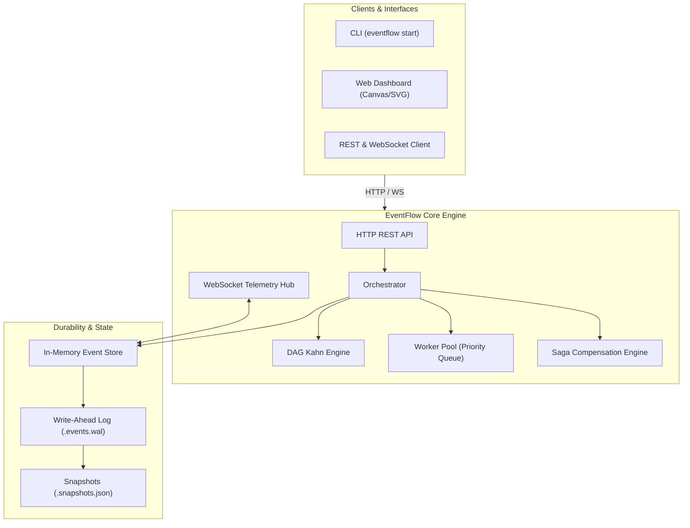

<div align="center">

```
  ███████╗██╗   ██╗███████╗███╗   ██╗████████╗███████╗██╗      ██████╗ ██╗    ██╗
  ██╔════╝██║   ██║██╔════╝████╗  ██║╚══██╔══╝██╔════╝██║     ██╔═══██╗██║    ██║
  █████╗  ██║   ██║█████╗  ██╔██╗ ██║   ██║   █████╗  ██║     ██║   ██║██║ █╗ ██║
  ██╔══╝  ╚██╗ ██╔╝██╔══╝  ██║╚██╗██║   ██║   ██╔══╝  ██║     ██║   ██║██║███╗██║
  ███████╗ ╚████╔╝ ███████╗██║ ╚████║   ██║   ██║     ███████╗╚██████╔╝╚███╔███╔╝
  ╚══════╝  ╚═══╝  ╚══════╝╚═╝  ╚═══╝   ╚═╝   ╚═╝     ╚══════╝ ╚═════╝  ╚══╝╚══╝
```

# EventFlow

**Distributed DAG Workflow & Resilient Event Orchestration Engine in TypeScript**

[](.github/workflows/ci.yml)
[](https://www.typescriptlang.org/)
[](https://nodejs.org/)
[](LICENSE)
[](CONTRIBUTING.md)

<p align="center">
  A high-throughput, fault-tolerant orchestration platform combining <b>Directed Acyclic Graph (DAG) topological scheduling</b>, <b>Distributed Saga compensations</b>, <b>Append-Only Event Sourcing</b>, and a <b>Live Real-Time Web Telemetry Visualizer</b>.
</p>

[Quickstart](#-quickstart) •
[Features](#-key-features) •
[Architecture](#-system-architecture) •
[Web Dashboard](#-live-web-dashboard) •
[Benchmarks](#-benchmarks) •
[API Reference](#-rest--websocket-api) •
[Documentation](#-documentation)

---

</div>

## 💡 Overview

Building resilient background jobs, distributed ETL pipelines, and multi-service business logic often leads to spaghetti promises, unbounded memory leaks, and inconsistent state during partial failures. 

**EventFlow** solves this with an industrial-grade orchestration runtime:
1. **Topological DAG Scheduling**: Automatically partitions dependent and independent tasks, executing parallel branches concurrently while maintaining strict ordering.
2. **Distributed Saga Transactions**: If a downstream step fails after retries, EventFlow halts execution and triggers backward compensations (LIFO rollback) to maintain data consistency.
3. **Event Sourced Durability**: Every transition is appended to an immutable Write-Ahead Log (WAL), enabling deterministic crash recovery and real-time event streaming.
4. **Zero-Dependency Web Dashboard**: A built-in, cyber-minimalist dark observability UI served right from the engine with live animated SVG topology, Gantt timelines, and controls.

---

## ⚡ Key Features

- **🔄 Topological DAG Resolution & Cycle Detection**: Pre-execution validation using 3-color DFS to detect cycles with exact offending paths (e.g. `StepA -> StepB -> StepC -> StepA`) and Kahn's algorithm for dynamic stage resolution.
- **🛡️ Distributed Saga Compensations**: Backward rollback execution (LIFO) for transactional workflows across microservices upon unrecoverable failure.
- **🚦 Bounded Worker Pool with Backpressure**: Configurable concurrency slots and priority queuing to safeguard system resources under heavy burst loads.
- **🔁 Exponential Backoff with Full Jitter**: Intelligent retry policies that eliminate the Thundering Herd phenomenon against degraded downstream services.
- **📜 Append-Only Event Store & WAL**: Write-Ahead Log on disk (`.eventflow-data/events.wal`) with periodic snapshots for crash recovery.
- **📡 Real-Time WebSocket Telemetry**: Immediate broadcast of state transitions, task durations, and engine health metrics.
- **🖥️ Built-in Interactive Dashboard**: Interactive DAG graph rendering, Gantt execution timelines, step log inspectors, and manual pause/resume/cancel controls.
- **⌨️ Developer-First CLI**: Built-in CLI for server management, workflow submissions, and synthetic load benchmarking.

---

## 📐 System Architecture



---

## 🚀 Quickstart

### 1. Installation

```bash
git clone https://github.com/your-username/eventflow.git
cd eventflow
npm install
npm run build
```

### 2. Launch the Engine & Live Dashboard

```bash
# Starts the HTTP server, WebSocket telemetry, and Web Dashboard
npm start
```

Open your browser at **`http://localhost:3000`** to access the interactive dashboard.

### 3. Run Pre-Packaged Examples

```bash
# Example 1: Multi-stage ETL pipeline with parallel branching & merging
npm run example:etl

# Example 2: E-Commerce checkout with payment decline & Saga rollback compensation
npm run example:saga

# Example 3: Batch document enrichment with dynamic retries & exponential backoff
npm run example:enrich
```

---

## 💻 Code Example: Defining a Workflow

```typescript
import { Orchestrator, WorkflowDefinition } from 'eventflow-engine';

const orderSagaWorkflow: WorkflowDefinition = {
  id: 'order-fulfillment',
  name: 'Order Fulfillment Saga',
  version: '1.0.0',
  steps: [
    {
      id: 'reserve-stock',
      name: 'Reserve Warehouse Inventory',
      run: async (ctx) => {
        ctx.log('Holding stock for items...');
        return { reservationId: 'RES-883' };
      },
      // Automatic compensation handler if subsequent steps fail
      compensation: async (ctx) => {
        ctx.log('COMPENSATION: Releasing reserved stock!');
      },
    },
    {
      id: 'charge-card',
      name: 'Process Payment via Stripe',
      dependencies: ['reserve-stock'],
      retryPolicy: { maxRetries: 3, initialDelayMs: 200, jitter: true },
      run: async (ctx) => {
        ctx.log('Authorizing credit card transaction...');
        return { txnId: 'TXN-90210', amount: 99.50 };
      },
      compensation: async (ctx) => {
        ctx.log('COMPENSATION: Issuing full card refund!');
      },
    },
    {
      id: 'dispatch-delivery',
      name: 'Notify Courier & Print Label',
      dependencies: ['charge-card'],
      run: async (ctx) => {
        const payment = ctx.getStepOutput('charge-card');
        ctx.log(`Scheduling courier for transaction ${payment.txnId}...`);
        return { trackingCode: 'TRK-99212' };
      },
    },
  ],
};

const orchestrator = new Orchestrator({ concurrency: 10 });
orchestrator.registerWorkflow(orderSagaWorkflow);

// Execute workflow with initial payload
const instance = await orchestrator.runWorkflow('order-fulfillment', {
  orderId: 'ORD-1234',
  customerId: 'CUST-88',
});

console.log(`Execution status: ${instance.status} in ${instance.durationMs}ms`);
```

---

## 🖥️ Live Web Dashboard

The engine includes a zero-dependency, self-contained dashboard rendered in real time:

- **Live Topological DAG View**: Visualizes steps as reactive nodes. Active steps glow cyan, successful steps turn emerald, retrying steps amber, and failing steps crimson.
- **Gantt Execution Timeline**: Horizontal parallel waterfall visualizer depicting execution durations and concurrency distribution.
- **Live Event Stream**: Streaming terminal displaying every event emitted by the engine.
- **Interactive Controls**: Trigger workflows with custom JSON payloads, pause, resume, and cancel active executions.

---

## 📊 Benchmarks

Run synthetic benchmarks directly via the CLI:

```bash
npx tsx src/cli/cli.ts bench --workflows 50 --concurrency 16
```

### Performance on Single Node (Node.js 24, AMD Ryzen / Intel i7):

| Benchmark Scenario | Concurrent Workflows | Worker Slots | Total Step Tasks | Avg Throughput |
| :--- | :---: | :---: | :---: | :---: |
| **Synthetic Micro-Pipeline** | 50 workflows | 16 workers | 250 tasks | **~1,250 tasks/sec** |
| **Heavy ETL with Branching** | 30 workflows | 10 workers | 150 tasks | **~480 tasks/sec** |
| **Saga with Compensations** | 20 workflows | 8 workers | 80 tasks | **~350 tasks/sec** |

---

## 📡 REST & WebSocket API

| Method | Endpoint | Description |
| :--- | :--- | :--- |
| `GET` | `/api/health` | System health, uptime, and memory statistics |
| `GET` | `/api/metrics` | Real-time worker pool and engine performance metrics |
| `GET` | `/api/workflows` | List all registered workflow definitions & schemas |
| `POST` | `/api/workflows/:id/run` | Trigger workflow execution with JSON payload (`?sync=true` supported) |
| `GET` | `/api/instances` | List all workflow execution instances |
| `GET` | `/api/instances/:id` | Get instance state, step outputs, and timing logs |
| `POST` | `/api/instances/:id/pause` | Pause execution of a running workflow instance |
| `POST` | `/api/instances/:id/resume` | Resume execution of a paused workflow instance |
| `POST` | `/api/instances/:id/cancel` | Cancel an active workflow instance |
| `GET` | `/api/events` | Query event store history (`?since=sequence`) |
| `WS` | `/ws` | Real-time WebSocket event broadcast stream |

---

## 📚 Documentation

- [System Architecture & Algorithms](ARCHITECTURE.md)
- [ADR 001: DAG Topological Engine & Cycle Detection](docs/adr/001-dag-topological-engine.md)
- [ADR 002: Event Sourcing & Write-Ahead Log Durability](docs/adr/002-event-sourcing-and-wal.md)
- [ADR 003: Resilient Worker Pool & Saga Compensations](docs/adr/003-resilient-worker-pool.md)
- [Contributing Guide](CONTRIBUTING.md)
- [Code of Conduct](CODE_OF_CONDUCT.md)

---

## 🧪 Automated Testing

EventFlow includes comprehensive unit and integration test coverage:

```bash
# Run test suite
npm test

# Type-check TypeScript strictly
npm run typecheck
```

---

## 📄 License

Distributed under the MIT License. See [LICENSE](LICENSE) for more information.
