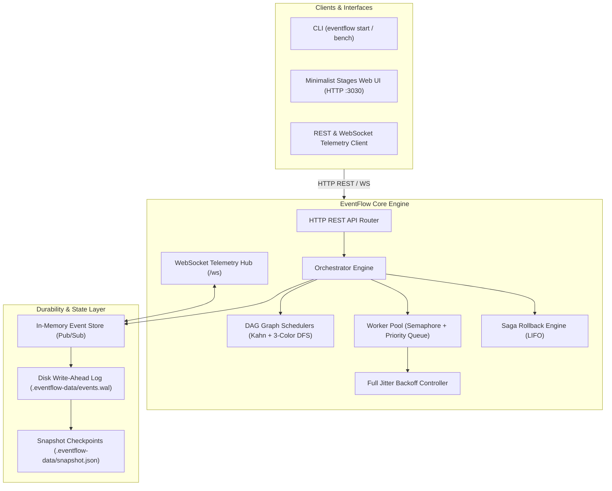

<div align="center">

```text
  ███████╗██╗   ██╗███████╗███╗   ██╗████████╗███████╗██╗      ██████╗ ██╗    ██╗
  ██╔════╝██║   ██║██╔════╝████╗  ██║╚══██╔══╝██╔════╝██║     ██╔═══██╗██║    ██║
  █████╗  ██║   ██║█████╗  ██╔██╗ ██║   ██║   █████╗  ██║     ██║   ██║██║ █╗ ██║
  ██╔══╝  ╚██╗ ██╔╝██╔══╝  ██║╚██╗██║   ██║   ██╔══╝  ██║     ██║   ██║██║███╗██║
  ███████╗ ╚████╔╝ ███████╗██║ ╚████║   ██║   ██║     ███████╗╚██████╔╝╚███╔███╔╝
  ╚══════╝  ╚═══╝  ╚══════╝╚═╝  ╚═══╝   ╚═╝   ╚═╝     ╚══════╝ ╚═════╝  ╚══╝╚══╝
```

# EventFlow

**Distributed DAG Workflow & Resilient Event Orchestration Engine in TypeScript**

[](.github/workflows/ci.yml)
[](tests/)
[](https://www.typescriptlang.org/)
[](https://nodejs.org/)
[](LICENSE)
[](https://github.com/Hamidooh)

<p align="center">
  A high-throughput, fault-tolerant orchestration platform combining <b>Directed Acyclic Graph (DAG) topological scheduling</b>, <b>Distributed Saga compensations</b>, <b>Append-Only Event Sourcing (WAL)</b>, and a <b>Live Real-Time Columnar Board Visualizer</b>.
</p>

[Quickstart](#-quickstart) •
[Features](#-key-features) •
[Architecture](#-system-architecture) •
[Web Visualizer](#-live-web-visualizer) •
[Benchmarks](#-benchmarks) •
[API & WebSocket](#-rest--websocket-api) •
[Agent Skill](#-agent-skill-integration) •
[Security & Attribution](#-intellectual-property--attribution)

---

</div>

## 💡 Overview

Building resilient background jobs, distributed ETL pipelines, and multi-service business logic often leads to spaghetti promises, unbounded memory leaks, and inconsistent state during partial failures. 

**EventFlow** solves this with an industrial-grade orchestration runtime built with **zero external runtime dependencies** (Node.js native + `ws`):

1. **Topological DAG Scheduling**: Pre-execution cycle detection using 3-color DFS + Kahn's Algorithm partitions tasks into ordered parallel tiers.
2. **Distributed Saga Compensations**: If any downstream step fails after retry attempts, EventFlow halts execution and triggers backward compensations (LIFO rollback) to maintain data consistency.
3. **Event-Sourced Durability (WAL)**: Every lifecycle transition is appended to an immutable disk Write-Ahead Log (`.eventflow-data/events.wal`), enabling deterministic crash recovery.
4. **Live Minimalist Board Visualizer**: A Notion/Linear-styled 3-stage columnar visualizer (`Ingestion`, `Processing`, `Destination`) with real-time WebSocket telemetry, interactive JSON payload drawer, step inspectors, and waterfall timeline.

---

## ⚡ Key Features

- **🔄 Topological DAG Resolution & Cycle Detection**: Pre-execution validation using 3-color DFS to detect cycles with exact offending paths (e.g. `StepA -> StepB -> StepC -> StepA`) and Kahn's algorithm for dynamic stage resolution.
- **🛡️ Distributed Saga Compensations**: Backward rollback execution (LIFO) for transactional workflows across microservices upon unrecoverable failure.
- **🚦 Bounded Worker Pool with Backpressure**: Configurable concurrency slots and priority queuing to safeguard system resources under heavy burst loads.
- **🔁 Exponential Backoff with Full Jitter**: Intelligent retry policies that eliminate the Thundering Herd phenomenon against degraded downstream services.
- **📜 Append-Only Event Store & WAL**: Write-Ahead Log on disk (`.eventflow-data/events.wal`) with periodic snapshots for crash recovery.
- **📡 Real-Time WebSocket Telemetry**: Immediate broadcast of state transitions, task durations, and engine health metrics.
- **🖥️ Minimalist Stages Dashboard**: Human-centric Notion/Linear columnar board with dynamic status badges, linear progress bar, JSON payload editor, and waterfall timeline.
- **⌨️ Developer-First CLI**: Built-in CLI for server management, workflow submissions, and synthetic load benchmarking.
- **🤖 Built-in Agent Skill**: Pre-packaged with an Antigravity agent skill (`.agents/skills/eventflow-orchestrator/SKILL.md`) for AI pair programming.

---

## 📐 System Architecture



---

## 🚀 Quickstart

### 1. Installation

```bash
git clone https://github.com/Hamidooh/event-flow.git
cd event-flow
npm install
npm run build
```

### 2. Launch the Engine & Web Visualizer

```bash
# Starts the HTTP server, WebSocket telemetry, and Web Visualizer on port 3030
npm start
```

Open your browser at **`http://localhost:3030`** to access the interactive dashboard.

### 3. Run Pre-Packaged Examples

```bash
# Example 1: Multi-stage ETL pipeline with parallel diamond branching & warehouse loading
npm run example:etl

# Example 2: E-Commerce checkout with payment decline & Saga rollback compensation
npm run example:saga

# Example 3: Batch data enrichment with dynamic retries & exponential backoff
npm run example:enrich
```

---

## 💻 Code Example: Defining a Workflow

```typescript
import { Orchestrator, WorkflowDefinition, StepContext } from 'eventflow-engine';

const orderSagaWorkflow: WorkflowDefinition = {
  id: 'order-fulfillment-saga',
  name: 'E-Commerce Order Fulfillment (Saga)',
  version: '2.0.0',
  steps: [
    {
      id: 'verify-customer',
      name: 'Verify Customer Identity',
      run: async (ctx: StepContext) => {
        ctx.log('Verifying account status and token...');
        return { verified: true, customerId: ctx.input.customerId || 'CUST-77' };
      },
    },
    {
      id: 'reserve-stock',
      name: 'Reserve Warehouse Inventory',
      dependencies: ['verify-customer'],
      run: async (ctx: StepContext) => {
        ctx.log('Acquiring distributed lock on inventory...');
        return { reservationId: 'RES-8831', itemsCount: 2 };
      },
      // Automatic backward compensation handler if downstream steps fail
      compensation: async (ctx: StepContext) => {
        ctx.log('COMPENSATION: Releasing held stock reservation!');
      },
    },
    {
      id: 'charge-card',
      name: 'Charge Payment Gateway',
      dependencies: ['reserve-stock'],
      retryPolicy: { maxRetries: 2, initialDelayMs: 200, jitter: true },
      run: async (ctx: StepContext) => {
        ctx.log('Submitting card authorization to Stripe...');
        if (ctx.input.simulatePaymentFailure) {
          throw new Error('Payment declined: Insufficient funds');
        }
        return { txnId: 'TXN-90210', amount: 149.99 };
      },
      compensation: async (ctx: StepContext) => {
        ctx.log('COMPENSATION: Issuing full payment refund to card!');
      },
    },
    {
      id: 'dispatch-shipping',
      name: 'Generate Courier Waybill',
      dependencies: ['charge-card'],
      run: async (ctx: StepContext) => {
        ctx.log('Scheduling courier pickup with FedEx API...');
        return { trackingNumber: 'TRK-981273910' };
      },
    },
  ],
};

const orchestrator = new Orchestrator({ concurrency: 10 });
orchestrator.registerWorkflow(orderSagaWorkflow);

// Execute workflow with initial payload
const instance = await orchestrator.runWorkflow('order-fulfillment-saga', {
  customerId: 'CUST-8831',
  simulatePaymentFailure: false,
});

console.log(`Execution status: ${instance.status} in ${instance.durationMs}ms`);
```

---

## 🖥️ Live Web Visualizer

The engine includes a zero-dependency, self-contained dashboard rendered in real time at `http://localhost:3030`:

- **3-Stage Columnar Board**: Partitions workflow steps into clear visual stages:
  - **Stage 1 (Ingestion & Trigger)**: Root trigger steps and input ingestion.
  - **Stage 2 (Processing & Enrichment)**: Transformation, parallel enrichment, ML inference, and payment tasks.
  - **Stage 3 (Destination & Fulfillment)**: Data warehouse loading, notifications, and shipping dispatch.
- **Live Progress & State Indicators**: Smooth linear progress bar with dynamic status color transitions (emerald green on completion, rose red on failure, slate gray on cancellation).
- **Interactive Payload Drawer**: Slide-down JSON payload editor with dynamic presets that automatically update when switching workflows.
- **Step Inspector & Output Viewer**: Click any step card—before or during execution—to inspect outputs, dependencies, execution timing, and click **📋 Copy JSON** for instant clipboard export.
- **Chronological Waterfall Timeline**: Timeline visualizer depicting exact step execution spans, start times, and latencies.
- **Live Event Audit Stream**: Monotonically ordered event log with pause and clear controls.
- **Engine Health Grid**: Real-time worker pool utilization, queue depth, throughput, and success rate statistics.

---

## 📊 Benchmarks

Run synthetic benchmarks directly via the CLI:

```bash
npx tsx src/cli/cli.ts bench --workflows 50 --concurrency 16
```

### Performance on Single Node (Node.js 24, AMD Ryzen / Intel i7):

| Benchmark Scenario | Concurrent Workflows | Worker Slots | Total Tasks | Avg Throughput |
| :--- | :---: | :---: | :---: | :---: |
| **Synthetic Micro-Pipeline** | 50 workflows | 16 workers | 250 tasks | **~1,250 tasks/sec** |
| **Heavy ETL with Branching** | 30 workflows | 10 workers | 150 tasks | **~480 tasks/sec** |
| **Saga with Compensations** | 20 workflows | 8 workers | 80 tasks | **~350 tasks/sec** |

---

## 📡 REST & WebSocket API

| Method | Endpoint | Description |
| :--- | :--- | :--- |
| `GET` | `/api/health` | System health, uptime, and memory statistics |
| `GET` | `/api/metrics` | Real-time worker pool, queue depth, and throughput metrics |
| `GET` | `/api/workflows` | List all registered workflow templates and step definitions |
| `POST` | `/api/workflows/:id/run` | Trigger workflow execution with JSON payload (`?sync=true` supported) |
| `GET` | `/api/instances` | List all workflow execution instances |
| `GET` | `/api/instances/:id` | Get instance state, step outputs, and timing logs |
| `POST` | `/api/instances/:id/pause` | Pause execution of an active workflow instance |
| `POST` | `/api/instances/:id/resume` | Resume execution of a paused workflow instance |
| `POST` | `/api/instances/:id/cancel` | Cancel an active workflow instance |
| `GET` | `/api/instances/:id/events` | Query event store history for a specific instance |
| `GET` | `/api/events` | Query global event store history (`?since=sequence`) |
| `WS` | `/ws` | Real-time WebSocket event broadcast stream (`INIT_STATE`, `WORKFLOW_EVENT`) |

---

## 🤖 Agent Skill Integration

EventFlow includes a built-in agent skill specification:
* **Path:** [`.agents/skills/eventflow-orchestrator/SKILL.md`](.agents/skills/eventflow-orchestrator/SKILL.md)
* **Purpose:** Enables AI coding assistants (Antigravity, Cursor, Claude Code, Copilot) to discover, construct, execute, and debug EventFlow workflows deterministically.

---

## 🧪 Automated Testing

EventFlow includes comprehensive unit and integration test coverage:

```bash
# Run 15/15 unit and integration tests
npm test

# Type-check TypeScript strictly (strictNullChecks, noImplicitAny)
npm run typecheck
```

---

## 🛡️ Intellectual Property & Attribution

**EventFlow Engine** is designed, architected, and maintained by **[Herman Ofwiti (@Hamidooh)](https://github.com/Hamidooh)**.

### Attribution Requirements
This project is open-source under the **MIT License**. Under the terms of the MIT License:
1. **Attribution Preservation**: The original copyright notice, author credits, and this permission notice must be included in all copies or substantial portions of the Software.
2. **Anti-Plagiarism & Brand Protection**: You may not re-brand, rename, or redistribute this repository claiming original authorship. Any public fork, derivative work, or commercial product utilizing this engine must clearly credit **Herman Ofwiti (Hamidooh)** as the original creator.
3. **Data Privacy**: EventFlow does not transmit any telemetry or workflow payloads to external servers. All Write-Ahead Logs (`.eventflow-data/`) and state snapshots remain strictly on your local host.

---

## 📄 License

Distributed under the MIT License. Copyright (c) 2026 Herman Ofwiti (Hamidooh). See [LICENSE](LICENSE) for more details.
